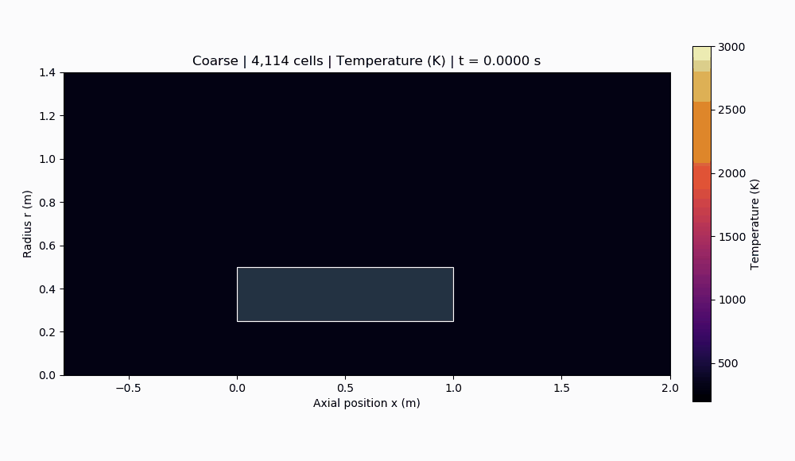
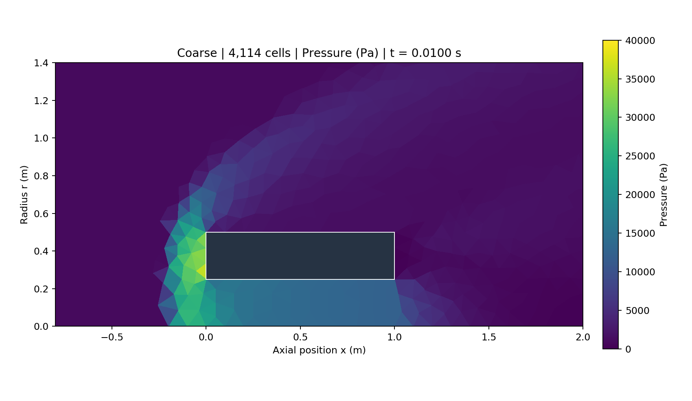
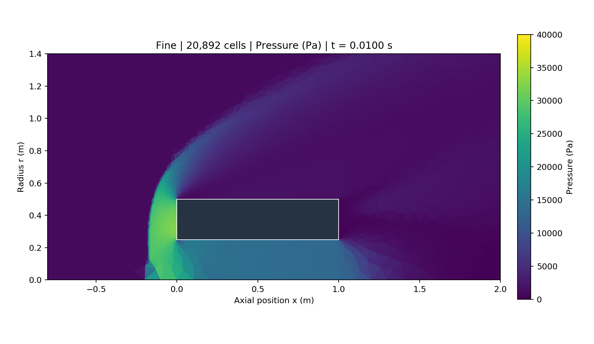
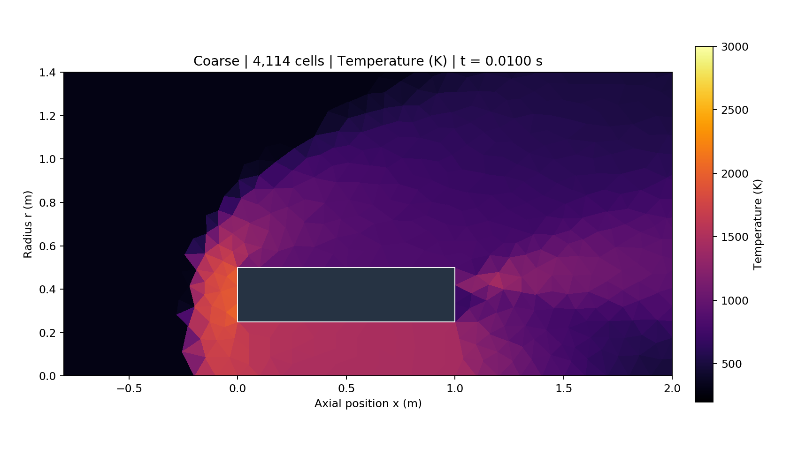
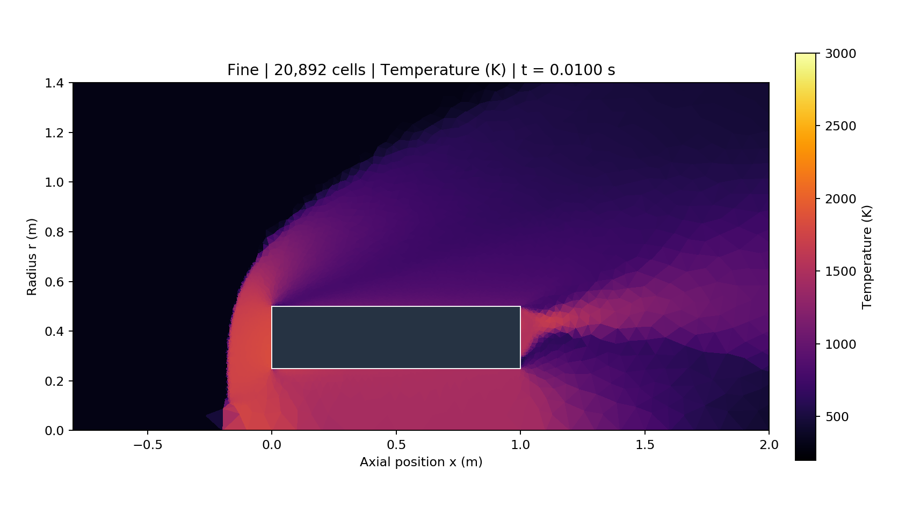
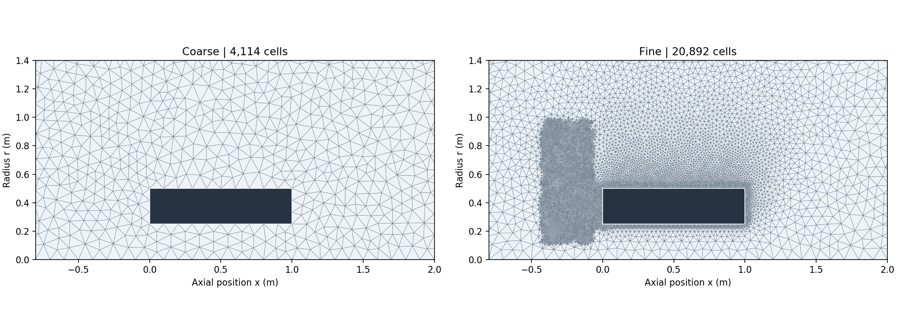
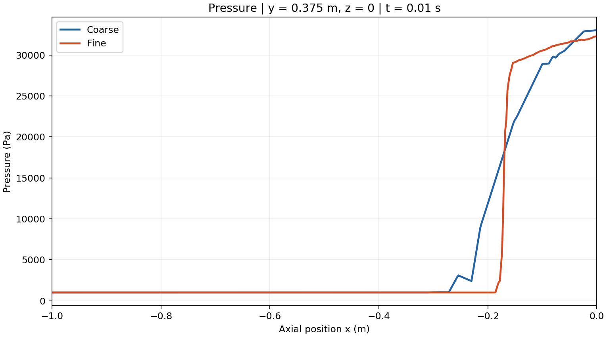
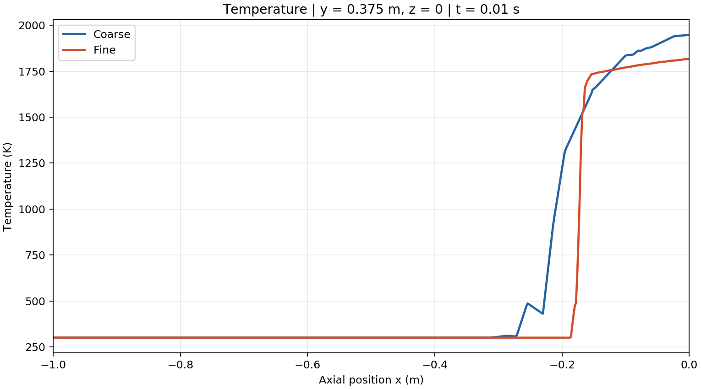

# Mach 5 flow around a hollow cylinder

This project demonstrates my OpenFOAM workflow for Mach 5 flow around an open hollow cylinder: building geometry in Gmsh, generating and checking an axisymmetric wedge mesh, configuring a compressible case, running serial and MPI calculations, and comparing saved results.

## Setup and tools

The cases use **OpenFOAM v1706**, the standard `rhoCentralFoam` solver, Gmsh, and Open MPI. ParaView 5.7 through `paraFoam` is the intended visualization tool. OpenFOAM `postProcess` and NumPy were used to audit the saved fields and extract line data; Matplotlib and Pillow generated the included figures and GIFs. No modified solver is included.

| Setting | Both cases |
|---|---|
| Freestream | U = (1736.37, 0, 0) m/s; p = 1000 Pa; T = 300 K; approximately Mach 5 |
| Geometry | Length 1 m, inner radius 0.25 m, outer radius 0.5 m; axis along x |
| Domain | x = −2 to 4 m, radius = 0 to 2.5 m; 5° axisymmetric sector |
| Inlet and farfield | Fixed freestream velocity, pressure, and temperature |
| Outlet | Zero-gradient U, p, and T |
| Cylinder walls | No-slip U; zero-gradient p and T (adiabatic) |
| Gas | Perfect gas, constant Cp = 1004.5 J/(kg K), molecular weight 28.96 kg/kmol |
| Transport and flow | Sutherland viscosity, As = 1.458e−6, Ts = 110.4 K; laminar |
| Thermodynamics | `hePsiThermo`, `pureMixture`, `hConst`, `sensibleInternalEnergy` |
| Numerics | Kurganov flux; Euler time stepping; upwind reconstruction of rho, U, and T |
| Time control | Initial deltaT = 1e−9 s; adaptive stepping; maxCo = 0.2; maxDeltaT = 1e−6 s |
| Saved results | 0 to 0.01 s, every 0.0005 s; 20 nonzero snapshots per case |

The 5° wedge represents an axisymmetric flow, including the bore; it suppresses circumferential disturbances.

## Geometry and refinement in Gmsh

The `.geo` files build a fluid cross-section from two rectangular curve loops. The outer rectangle defines the domain. Removing the inner rectangle, x = 0–1 m and r = 0.25–0.5 m, leaves the hollow-cylinder wall as an excluded solid region while preserving fluid through the bore. The surface is rotated −2.5° about the x axis and rotationally extruded by 5° with one layer. Gmsh creates a triangular cross-section and predominantly prismatic volume cells, with degenerate cells near the axis. Named physical surfaces become the inlet, outlet, farfield, cylinder-wall, and wedge patches in OpenFOAM.

The coarse geometry uses a nominal 0.1 m point size. The fine geometry combines two Gmsh `Box` size fields using `Min`, requesting 0.01 m inside each box and 0.1 m outside:

| Refinement region | x range (m) | y range (m) | Purpose |
|---|---|---|---|
| Cylinder wall and lips | −0.05 to 1.05 | 0.20 to 0.55 | Add cells around both lips, the bore, and the outer wall where compression, expansion, and velocity/temperature changes occur |
| Upstream shock region | −0.45 to −0.05 | 0.10 to 1.00 | Concentrate cells ahead of the leading annular face to reduce shock smearing and examine sensitivity of its position |

Both boxes span z = −0.1 to 0.1 m. This is local size refinement, with no dedicated wall-normal boundary-layer stack. Much of the downstream wake remains relatively coarse. The historical Gmsh 4.4.1 run ignored three newer mesh-option names in the fine file; the meshing script explicitly preserves that effective behavior. Details are in [the audit](docs/AUDIT.md).

| Verified original mesh | Coarse | Fine |
|---|---:|---:|
| Cells | 4,114 | 20,892 |
| Cylinder-wall faces | 26 | 250 |
| Maximum non-orthogonality | 30.1891° | 47.0855° |
| Maximum skewness | 0.465786 | 0.683587 |
| Fresh `checkMesh` | Mesh OK | Mesh OK |
| Solver processes | 1 | 4 |

## Results and comparison

Both runs reached 0.01 s and ended normally. Between 0.0095 and 0.01 s, volume-weighted pressure changes are 0.146% and 0.155% for coarse and fine; temperature changes are 0.0382% and 0.0476%. These indicate reduced changes in saved snapshots, not a proof of full convergence. Final internal-cell temperature maxima are 2004.95 K and 1851.53 K. The [audit data](results/audit.json) contain all saved-time checks.

Pressure and temperature have been sampled at **501 identical points from (−1, 0.375, 0) to (0, 0.375, 0), at t = 0.01 s**. The second endpoint lies on the front annular wall. Download the [coarse CSV](results/coarse/line.csv) and [fine CSV](results/fine/line.csv); columns include coordinates, pressure in Pa, and temperature in K. Extraction uses OpenFOAM `cellPoint` interpolation. Spatial interpolation does not add CFD resolution.

The figures and animations below were generated automatically with Python from the existing OpenFOAM results. ParaFoam could not render in the delivery environment; this is a documented fallback, not a ParaView export. Field images show actual cell values on a wedge face projected to axial position and radius, with no contour smoothing. Both cases use the same crop, colormap, and fixed scales: 0–40,000 Pa for pressure and 200–3,000 K for temperature. GIFs use all 21 stored states including the initial condition at 12.5 fps, with a final-frame hold and no temporal interpolation.

| Coarse: 4,114 cells | Fine: 20,892 cells |
|---|---|
|  |  |
|  |  |
|  |  |



The refined mesh resolves the compression front more sharply and changes its apparent location. Local refinement covers the wall/lips and an upstream box, while the upper shock and wake still cross coarser cells. This illustrates mesh sensitivity; no precise shock-location measurement or validated accuracy improvement is claimed.




The line plots compare OpenFOAM `cellPoint` samples, not a derivative or pressure-gradient estimate. [Sampling location](results/line_location.png) and [saved-time settling diagnostics](results/settling.png) are included. [Visualization notes](docs/VISUALIZATION.md) explain the Python method and the remaining ParaFoam blocker.

## Reproduce the workflow

Use a fresh checkout with Gmsh **4.4.1** and a sourced OpenFOAM **v1706** environment. Gmsh 4.4.1 was tested; other versions may change mesh generation. Mesh sizes, point coordinates, and connectivity were reproduced exactly with the supplied script.

```bash
bash scripts/mesh.sh coarse
bash scripts/mesh.sh fine
```

The script runs `gmsh -3 -format msh2`, imports with `gmshToFoam`, changes `wedgeFront` and `wedgeBack` to mesh type `wedge` and `cylinderWalls` to `wall`, then runs `checkMesh`. It refuses to replace an existing mesh. The field patch conditions are already in `0/`. An unused inherited `blockMeshDict` is omitted because Gmsh generates these meshes.

To run new simulations yourself:

```bash
(cd cases/coarse && rhoCentralFoam > log.rhoCentralFoam 2>&1)
(cd cases/fine && decomposePar > log.decomposePar 2>&1)
(cd cases/fine && mpirun -np 4 rhoCentralFoam -parallel > log.parallel 2>&1)
(cd cases/fine && reconstructPar > log.reconstructPar 2>&1)
paraFoam -case cases/coarse -builtin
paraFoam -case cases/fine -builtin
```

No CFD solver was rerun while preparing this portfolio. Mesh generation, patch correction, mesh checking, and four-way decomposition were tested. The supplied v1706 numerical and physical dictionaries are unchanged from the completed runs. Saved solution directories and processor data are excluded from Git; regenerating the fields requires running the commands above or using your retained originals.

Install the analysis dependencies with `python3 -m pip install -r requirements.txt`. Audit, sample, and render existing reconstructed results without changing their source directories:

```bash
python3 scripts/audit_fields.py /path/to/coarse-results /path/to/fine-results
python3 scripts/sample_lines.py /path/to/coarse-results /path/to/fine-results
python3 scripts/render_results.py /path/to/coarse-results /path/to/fine-results
```

`sample_lines.py` works on temporary copies and invokes only `postProcess`. [Audit notes](docs/AUDIT.md) cover reconstruction verification and the limits of these checks.

## Limits

Two locally refined meshes demonstrate mesh sensitivity, not mesh independence. No experiment, benchmark, systematic grid sequence, timestep study, or transition/turbulence study establishes quantitative accuracy. First-order reconstruction smears sharp changes; wall and wake resolution remain limited. Constant heat capacity and a single-temperature perfect gas simplify hypersonic thermodynamics. Adiabatic walls do not provide a prediction of heat load into a cooled body. The computed temperature peaks and unresolved sensitivities require further investigation before quantitative aerodynamic or thermal use.
